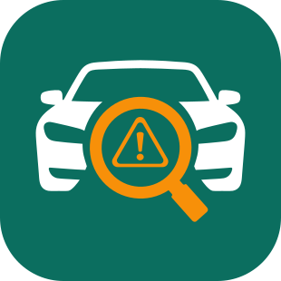
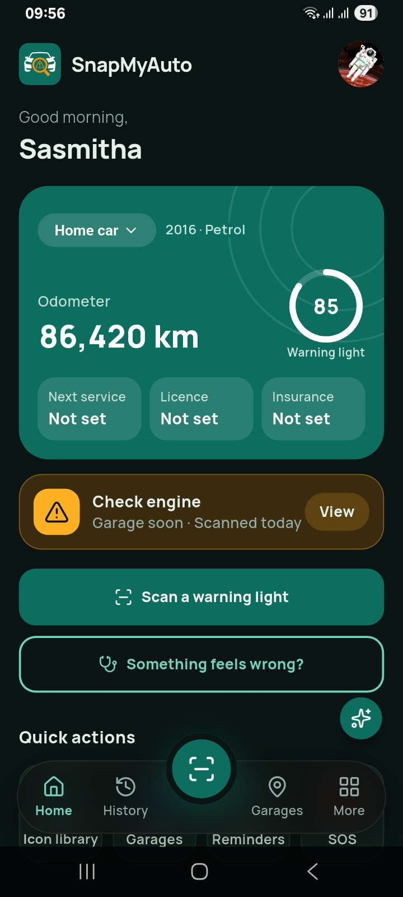
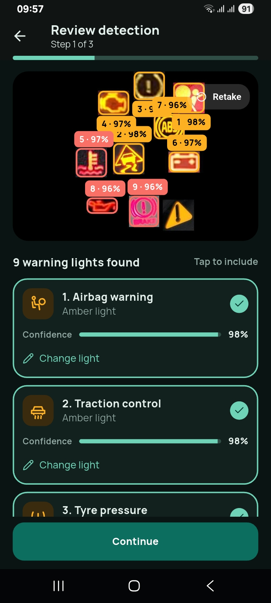
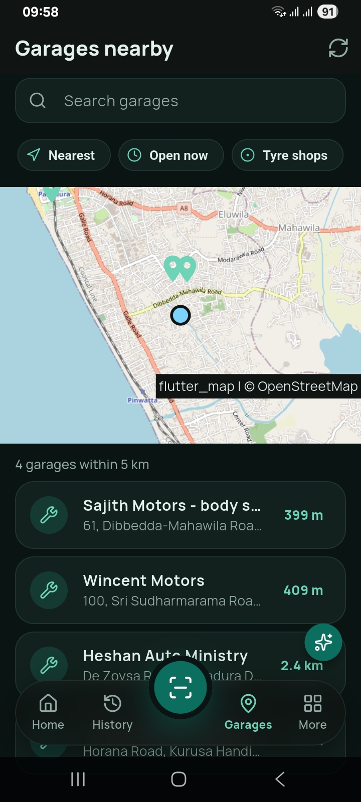
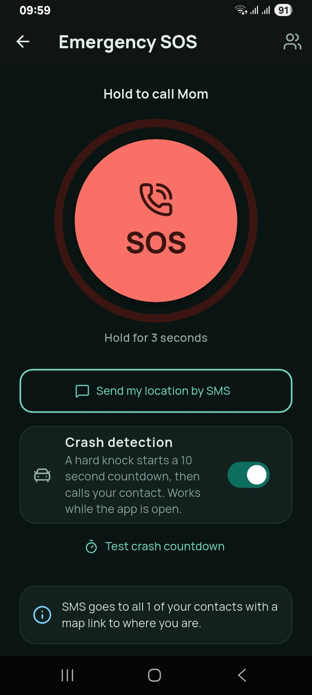
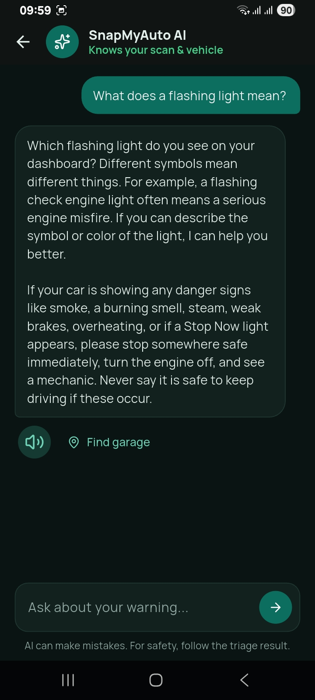
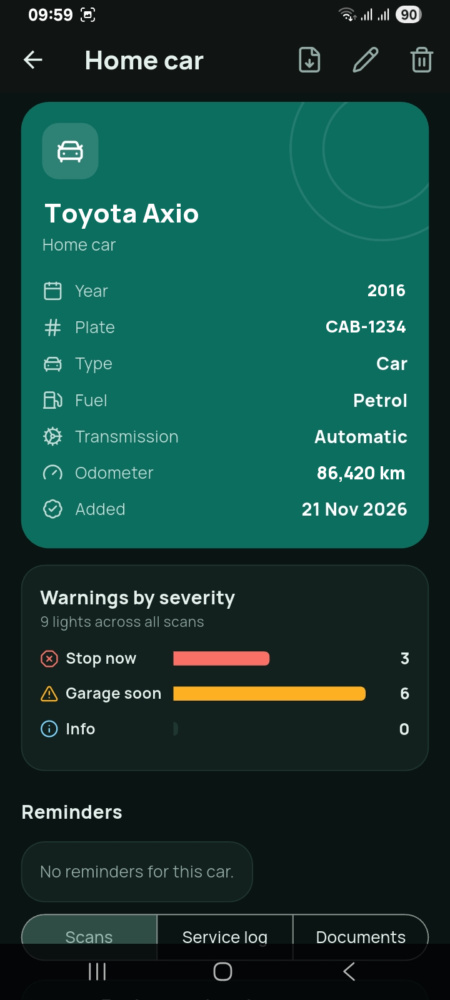

<p align="center">
  
</p>

<h1 align="center">SnapMyAuto</h1>

<p align="center">
  Snap a photo of your car's dashboard and find out what each warning light means, how serious it is, and what to do next.
</p>

<p align="center">
  <a href="https://github.com/snapmyauto/snapmyauto-app/releases/latest"></a>
  <a href="LICENSE"></a>
  
  
  
  
  
  
</p>

SnapMyAuto runs its own object detection model, **DashLight**, on the phone, so a scan works even with no internet.

## Download

Get the latest APK from [Releases](https://github.com/snapmyauto/snapmyauto-app/releases/latest). Most phones use `app-arm64-v8a-release.apk`.

## Features

**Scan and triage**
- Detect warning lights from the camera or a gallery photo, fully on device
- Review the result: remove wrong lights, or pick from the top suggestions when the model is unsure
- Severity for every light: Stop now, Garage soon, Safe or Info
- Symptom check (smoke, noises, overheating) that changes the result
- "Can I keep driving?" answer with clear next steps
- Read the result aloud

**Help when you need it**
- Nearby garages on a map (OpenStreetMap), with search and Nearest / Open now / Tyre shop filters
- SOS: hold for 3 seconds to call your emergency contact, or send your location by SMS with a preview first
- Crash detection: a hard knock starts a 10 second countdown, then calls your contact
- AI chat (Gemini) that knows your scan result and your car

**Look after your car**
- Vehicles: car, van, motorbike or three-wheeler, fuel type and transmission
- Health score out of 100 on the home screen
- Reminders by date or mileage, with notifications days before
- Vehicle detail with a warnings chart, scan history, service log and documents
- Export a vehicle report or all your data as a PDF
- Icon library with every warning light explained

**Everything else**
- Email and Google sign-in, email verification, change password, delete account
- English, Sinhala and Tamil
- Light and dark mode, green or blue accent
- Works offline for scanning, the icon library and SOS calls

## Screenshots

| Home | Scan review | Garages |
|:---:|:---:|:---:|
|  |  |  |

| SOS | AI chat | Vehicle |
|:---:|:---:|:---:|
|  |  |  |

## DashLight model

| | |
|---|---|
| Version | v1.0 |
| Lights it can detect | 15 |
| Accuracy (mAP@50) | 0.847 |
| Format | TensorFlow Lite, 640 x 640 input |

Training code and the model release live in the public [dashlight](https://github.com/snapmyauto/dashlight) repo.

## Tech stack

[](https://skillicons.dev)

- Flutter 3.47 (Dart 3.13), Material 3
- Riverpod 3 for state, go_router 18 for navigation
- Firebase: Authentication, Cloud Firestore, AI Logic (Gemini)
- tflite_flutter for on-device detection
- flutter_map + Overpass / Nominatim for garages
- geolocator, sensors_plus, flutter_tts, flutter_local_notifications, pdf + printing

## Project structure

```
lib/
  core/        theme, router, shared widgets, utils
  features/    one folder per feature
    <feature>/
      data/          Firebase and local storage
      domain/        models and logic
      presentation/  screens and widgets
  l10n/        English, Sinhala and Tamil text
assets/
  models/      dashlight.tflite + labels.txt
```

## Run it

1. Install Flutter 3.47 and Android Studio with an emulator.
2. Get the packages and run:
   ```bash
   flutter pub get
   flutter run
   ```
3. For Google sign-in on your own machine, add your debug SHA-1 to the Firebase project:
   ```bash
   cd android && ./gradlew signingReport
   ```

Run the tests with `flutter test`.

The Firebase project is private. To run your own copy, create a Firebase project and connect it with `flutterfire configure`.

## Release build

Release builds are signed with a key that is never committed. Create `android/key.properties`:

```properties
storePassword=...
keyPassword=...
keyAlias=...
storeFile=C:/path/to/release.jks
```

Then build one APK per phone type (about 40 MB each instead of one 100 MB file):

```bash
flutter build apk --release --split-per-abi
```

Most phones use `app-arm64-v8a-release.apk`. Without `key.properties` the build falls back to the debug key.

## Safety

SnapMyAuto gives general advice. It does not replace a mechanic. If a red light comes on, stop safely before you check the app.

## Contact

Questions, bugs or ideas? Send an email:

[](mailto:dev.sasmitha@gmail.com)

## License

[MIT](LICENSE)
